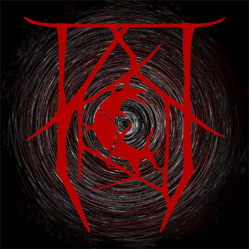

<p align="center">
  
</p>

# The Exiles of Shadowland - Launcher

The launcher for **The Exiles of Shadowland**, a Vintage Story roleplay server. One button gets a player onto the server: it installs the right game, keeps the server's mods in sync and connects straight to the server.

> [!NOTE]
> The server is in **Early Access**. The launcher is unofficial and not affiliated with Anego Studios, the developers of [Vintage Story](https://www.vintagestory.at).

## For players

1. Download `eos-launcher-<version>-setup.exe` from the [latest release](https://github.com/Tiisma/eos-launcher/releases/latest) and run it. The installer is not code-signed yet, so Windows SmartScreen may show "Unknown publisher": choose **More info**, then **Run anyway**. The release lists the installer's SHA-256 in `SHA256SUMS.txt`.
2. Sign in to your Vintage Story account with the button in the top-left corner.
3. Click **Link my Discord** and approve in your browser. You only do this once.
4. Once your whitelist is validated on the server's Discord, click **Play**.

The launcher updates itself: at startup (and every 30 minutes while it is open) it looks for a newer release on GitHub, downloads it and restarts into it. Play waits for that update, which is required, but never interrupts a running game. If GitHub cannot be reached, you can still play. Versions 0.1.1 and older do not update themselves: install the latest release by hand once.

The first Play installs Vintage Story 1.22.7 with [Optimum](https://github.com/StratumServer/Optimum) and the server's mods, which takes a few minutes. After that, Play only downloads what changed.

The launcher keeps everything in `%APPDATA%\EoSLauncher` (the game, its folder, backups, settings and logs), apart from any other launcher. See the [privacy policy](PRIVACY.md) for what it stores and contacts.

## What it does

- **Pinned game version**: Vintage Story 1.22.7, with the latest Optimum release that supports it.
- **Server mod pack**: the server publishes its pack; the launcher downloads public mods from the ModDB and the server's own mods from the server, checks every archive's SHA-256, and only removes files it installed itself.
- **Discord whitelist**: the launcher is linked to a Discord account once. The server only lets in players whose Discord account holds the whitelist role, and a single-use launch ticket proves each connection came from the launcher, so no command is ever typed in game.
- **Straight to the server**: the game starts connected to the server, without its main menu.
- **Players online** on the home screen.

The server side of this (the Discord bot, the whitelist gate and the pack) lives in a separate repository, `Tiisma/eos-gate`.

## For developers

```bash
npm ci
npm run dev        # run from source
npm test           # unit and component tests
npm run build:win  # Windows installer in dist/
```

Everything specific to the server (game version, server address, gate URL) is in [`src/domain/sombreterre/profile.ts`](src/domain/sombreterre/profile.ts). [`docs/sombreterre.md`](docs/sombreterre.md) describes how the fork works; the rest of `docs/` is RiftLauncher's own documentation, kept as a reference for the inherited code.

Releases are built by GitHub Actions: pushing a `v*` tag drafts a release with the Windows installer, its SHA-256 and the update metadata (`latest.yml`, blockmap), published by hand after review. Installed launchers update to a release once it is published; see [Launcher updates](docs/sombreterre.md#launcher-updates).

## Credits and licence

This launcher is a fork of [RiftLauncher](https://github.com/StratumServer/RiftLauncher) by [Zaldaryon](https://github.com/Zaldaryon) and the [Stratum](https://github.com/StratumServer) team, itself a fork of [VS Launcher](https://github.com/XurxoMF/vs-launcher) by [XurxoMF](https://github.com/XurxoMF). Nearly everything the launcher can do started with them; see [their contributors](docs/important-info/contributors.md). Please report problems with this fork here, not to them.

Released under the [MIT licence](LICENSE).
